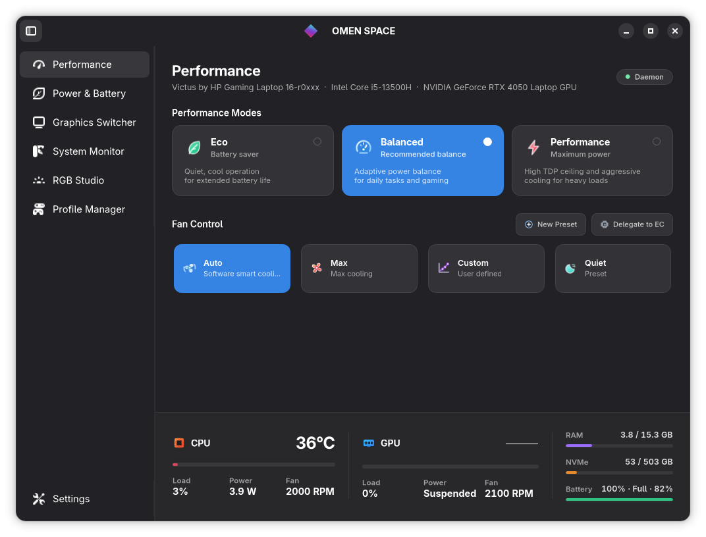

<div align="center">
  

  # OMEN Space

  **Centro de control nativo en Linux para portátiles HP OMEN, Victus y Transcend.**  
  Escrito íntegramente en **Rust** con **GTK4 y Libadwaita** para un rendimiento instantáneo y mínimo consumo.

  <p>
    <a href="https://github.com/yunusemreyl/omen-space/releases/latest">
      
    </a>
    <a href="LICENSE">
      
    </a>
    
    
  </p>

  <p>
    <a href="README.md">English</a> · <b>Español</b>
  </p>

  <br />
  
</div>

---

## Descripción general

**OMEN Space** ofrece control total del hardware en Linux mediante un daemon nativo en Rust (~3 MB) y una interfaz moderna en GTK4 + Libadwaita.

| Módulo | Funciones principales |
| :--- | :--- |
| **Rendimiento y Refrigeración** | Perfiles térmicos `Eco`, `Balanced` y `Performance`; modos de ventilador `Auto`, `Max`, curvas independientes para CPU y GPU con botón rápido **Nuevo preajuste**, delegación al **EC**, limpieza de polvo y barra de telemetría inferior fija sin cajas (`CPU`, `GPU`, `RAM`, `NVMe`, `Batería`). |
| **Monitor del Sistema** | Gráficos en tiempo real de 60 s con selector **Potencia / Temp / Carga** para CPU y GPU, barra resumen de potencia y modos activos, uso por disco, panel dedicado de **Batería y energía** y metadatos de firmware (`OS`, `BIOS`, `EC`, `NVIDIA`). |
| **Energía y Batería** | Limitador de carga de batería HP WMI `0x2B` / nativo con histéresis (`stop`/`start`, protección apagado `hold` y bypass único al 100 %), límites Intel RAPL `PL1`/`PL2`, `TCC Offset`, undervolt por MSR (`UV_LOCK`), GPU Dynamic Boost y ajustes AMD Ryzen SMU. |
| **Selector de Gráficos (MUX y PRIME)** | Cambio validado por hardware entre **Hybrid (MSHybrid)**, **Discrete (dGPU)**, **Advanced Optimus** e **Integrated**, enrutamiento de pantallas, estado pasivo `D3cold` y copia rápida de **PRIME Offload**. |
| **RGB Studio** | Iluminación RGB de 4 zonas, zona única (Victus), barra de luz frontal, Desktop RGB y teclado por tecla HID (Darfon `0d62:54bf` / `0d62:30bf` y Primax `0xFF13`) con vista previa sincronizada con el daemon, calibración física y distribución EN/DE. |
| **Control Rápido (`Shift+F2`, configurable)** | Superposición flotante nativa en Libadwaita con atajos de teclado (`1–3`, `Q/W/E`), soporte de teclas en múltiples dispositivos y telemetría en vivo. |
| **Centro de Ajustes Unificado** | Pestañas **General \| Actualizaciones \| Diagnóstico** con volcado completo para GitHub, comprobación OTA + `fwupd` (LVFS) y perfiles automáticos por aplicación. |

---

## Instalación rápida

```bash
curl -sSL https://raw.githubusercontent.com/yunusemreyl/omen-space/main/install.sh | sudo bash -s -- --stable
```

Para instalar directamente desde la rama `main` (canary):

```bash
curl -sSL https://raw.githubusercontent.com/yunusemreyl/omen-space/main/install.sh | sudo bash -s -- --canary
```

---

## Galería

<p align="center">
  
  
</p>
<p align="center">
  
  
</p>
<p align="center">
  
  
</p>

<details>
<summary><b>Más vistas (Control Rápido, Actualizaciones, Diagnóstico y CLI)</b></summary>
<br />
<p align="center">
  
  
</p>
<p align="center">
  
  
</p>
</details>

---

## Novedades en v2.5.1

- **Soporte verificado para placas `8EDF` y `8D42` (`#394`, `#358`):** Compatibilidad completa en `verified_boards` para **HyperX OMEN 15-ga0xxx (`8EDF`)** (corrigiendo el error `-22` de perfil térmico y evitando apagar la retroiluminación USB mediante `no_wmi_rgb_boards` / `disable_wmi_rgb`) y **OMEN MAX 16-ah0xxx (`8D42`)** (calibración de 120 LEDs `LampArray`).
- **Corrección de ventiladores al máximo y seguridad EC (`#395`, `#364`):** Reinicio por kernel `hp_wmi_fan_speed_max_reset()` al salir de `PWM_MODE_MAX`, curva `Auto` equilibrada refinada (`88°C -> 88%`, `93°C -> 100%`), salida limpia tras la limpieza de polvo, restricción estricta de escrituras `ec_sys` y deduplicación del aviso `No HP hwmon device found`.
- **RGB Primax `0xFF13` y 4 zonas, fallback MUX y refactorización (`#385`, `#393`, `#369`, `#361`):** Transmisión por software para `Marquee`, `Reactive`, `Ripple`, `Wave` y `Blinking` en Primax `0461:4F03`, corrección del tinte residual en zona 4, límites corregidos de 4 zonas en `8A17`, fallback automático a `graphics_mode` en el MUX de `8DCF`, mejoras de diagnóstico OpenRC y modularización de `fan/`, `rgb/`, automatización y cliente D-Bus de la GUI.

---

## Documentación y Seguridad

- **[Registro de cambios](CHANGELOG.md)** · **[Política de seguridad](SECURITY.md)** · **[Guía de instalación](docs/INSTALACION.es.md)**

---

## Licencia

Distribuido bajo la licencia **GPL-3.0**.  
*OMEN Space es un proyecto independiente de código abierto y no está afiliado ni respaldado por HP Inc.*
