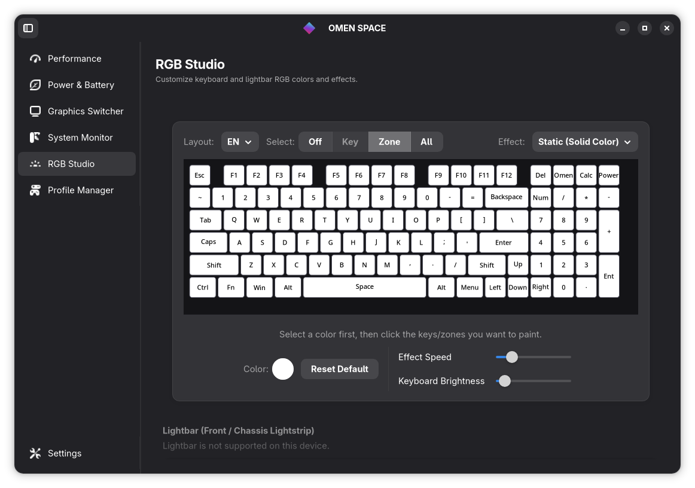
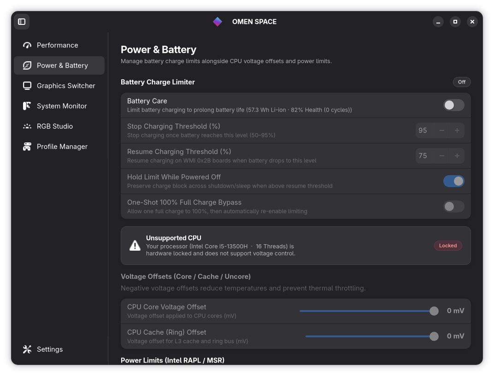
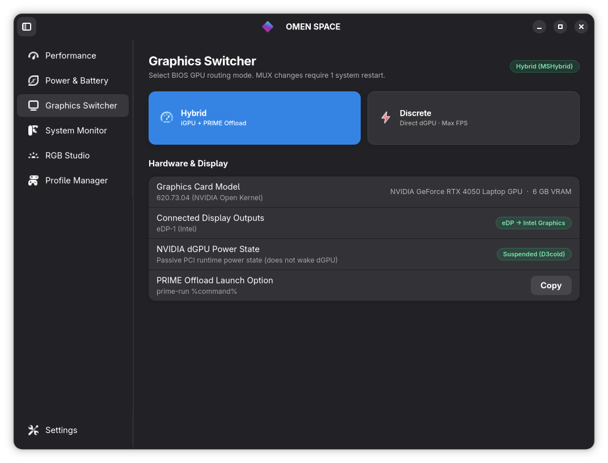
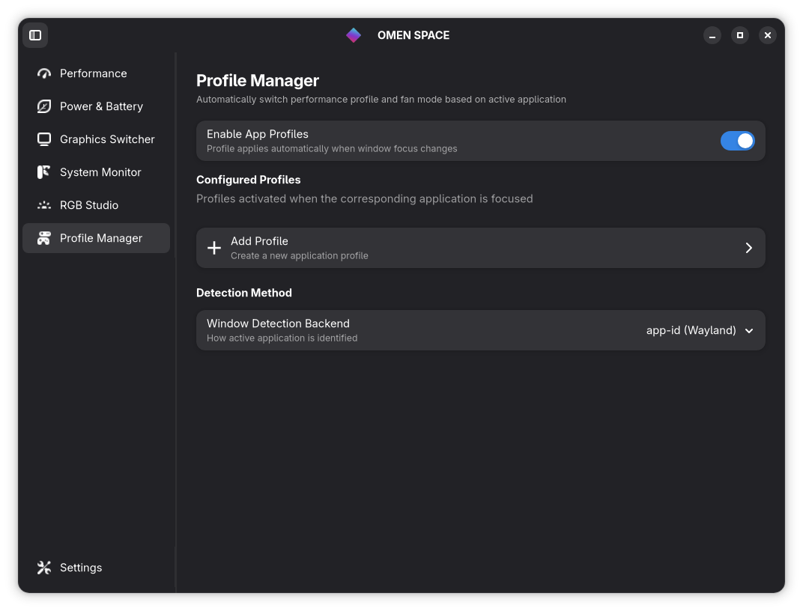
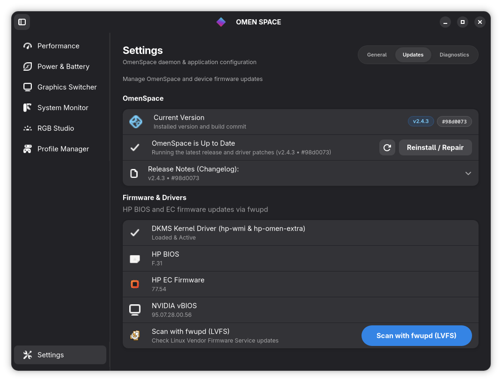
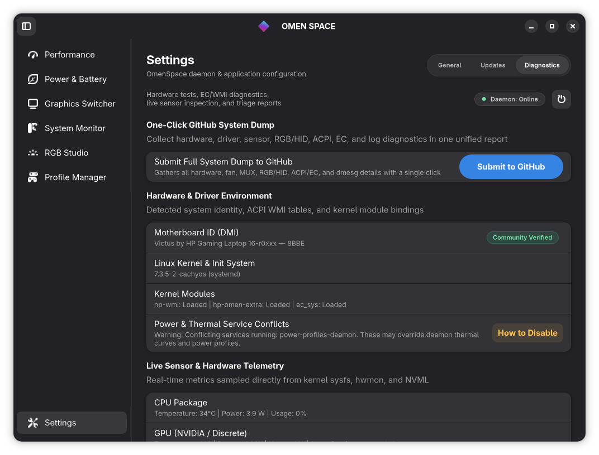

<div align="center">
  

  # OMEN Space

  **Centro de control nativo en Linux para portátiles HP OMEN, Victus y Transcend.**  
  Escrito íntegramente en **Rust** con **GTK4 y Libadwaita** para un rendimiento instantáneo y mínimo consumo.

  <p>
    <a href="https://github.com/yunusemreyl/omen-space/releases/latest">
      
    </a>
    <a href="LICENSE">
      
    </a>
    
    
  </p>

  <p>
    <a href="README.md">English</a> · <b>Español</b>
  </p>

  <br />
  
</div>

---

## Descripción general

**OMEN Space** ofrece control total del hardware en Linux mediante un daemon nativo en Rust (~3 MB) y una interfaz moderna en GTK4 + Libadwaita.

| Módulo | Funciones principales |
| :--- | :--- |
| **Rendimiento y Refrigeración** | Perfiles térmicos `Eco`, `Balanced` y `Performance`; modos de ventilador `Auto`, `Max`, curvas independientes para CPU y GPU con preajustes guardados, delegación directa al **EC**, limpieza de polvo y protección térmica con rebote de 3 s (`>= 90 °C` / `95 °C`). |
| **Energía Avanzada** | Límites de potencia Intel RAPL `PL1` / `PL2` (hasta 250 W / 300 W), límite térmico `TCC Offset`, undervolt por MSR (con detección de `UV_LOCK`), Dynamic Boost de GPU y ajustes para AMD Ryzen SMU. |
| **Selector de Gráficos (MUX)** | Cambio entre **Hybrid (MSHybrid)**, **Discrete (dGPU)** y **Advanced Optimus** con estado de enrutamiento `eDP`, verificación de lectura y versión del controlador NVIDIA. |
| **RGB Studio** | Iluminación RGB de 4 zonas, zona única (Victus), barra de luz frontal, Desktop RGB y teclado por tecla HID LampArray Darfon (`0d62:54bf` / `0d62:30bf`) con calibración física, selector de distribución EN/DE y animaciones de bajo consumo. |
| **Superposición Rápida (`Shift+F2`, configurable)** | Panel flotante personalizable dentro del juego y applet de bandeja del sistema sincronizados en tiempo real. |
| **Centro de Depuración y Actualizador** | Volcado completo del sistema con un clic para GitHub, reglas por aplicación (Wayland y X11) y **Centro de Actualizaciones** con soporte `systemd` / **OpenRC** y firma automática Secure Boot MOK. |

---

## Instalación rápida

```bash
curl -sSL https://raw.githubusercontent.com/yunusemreyl/omen-space/main/install.sh | sudo bash -s -- --stable
```

Para instalar directamente desde la rama `main` (canary):

```bash
curl -sSL https://raw.githubusercontent.com/yunusemreyl/omen-space/main/install.sh | sudo bash -s -- --canary
```

---

## Galería

<p align="center">
  
  
</p>
<p align="center">
  
  
</p>
<p align="center">
  
  
</p>

---

## Novedades en v2.4.2

- **Selector GPU MUX según hardware y Advanced Optimus en Linux:** Expone las capacidades reales de MUX de la BIOS en `/sys/devices/platform/hp-wmi/gpu_mux_supported_modes`, oculta Advanced Optimus en equipos no compatibles tanto en la GUI como en la bandeja del sistema, muestra el estado pasivo D3cold de la dGPU y las salidas conectadas, y añade una guía con botón de copia rápida para **Steam / PRIME Offload**.
- **Limitador de carga de batería (`0x2B` GBCC/SBCC) en Energía y Batería:** Añade control por kernel `hp-wmi` (`battery_charge_mode`) y daemon con histéresis (`stop`/`start`, modo `hold` al apagar y carga completa puntual) ubicado en la parte superior de la página **Energía y Batería**.
- **Corrección de Shift+F2 / Quick Overlay en Wayland/X11:** Convierte la comprobación de sockets Unix a `SOCK_NONBLOCK | SOCK_CLOEXEC` para eliminar bloqueos en `/tmp/.X11-unix/X1` bajo KDE Wayland, prioriza `:0` y añade antirrebote de 250 ms al atajo.
- **Controlador RGB por tecla Primax `0xFF13`:** Soporte HID McuSDK2 para teclados Primax por tecla (`0461:4F03`, `4E9A`, `4E9B`, `4F11`, `4F1E`, `4ECB`, #385).
- **Resumen v2.4.1 / v2.4.0:** Consistencia visual GTK4/Libadwaita, localización ES/EN/TR completa, atajo configurable e inicio ~33% más rápido (#384, #386), curvas de ventilación independientes (#371), LampArray `0d62:30bf` y soporte nativo OpenRC (#364).

---

## Licencia

Distribuido bajo la licencia **GPL-3.0**.  
*OMEN Space es un proyecto independiente de código abierto y no está afiliado ni respaldado por HP Inc.*
