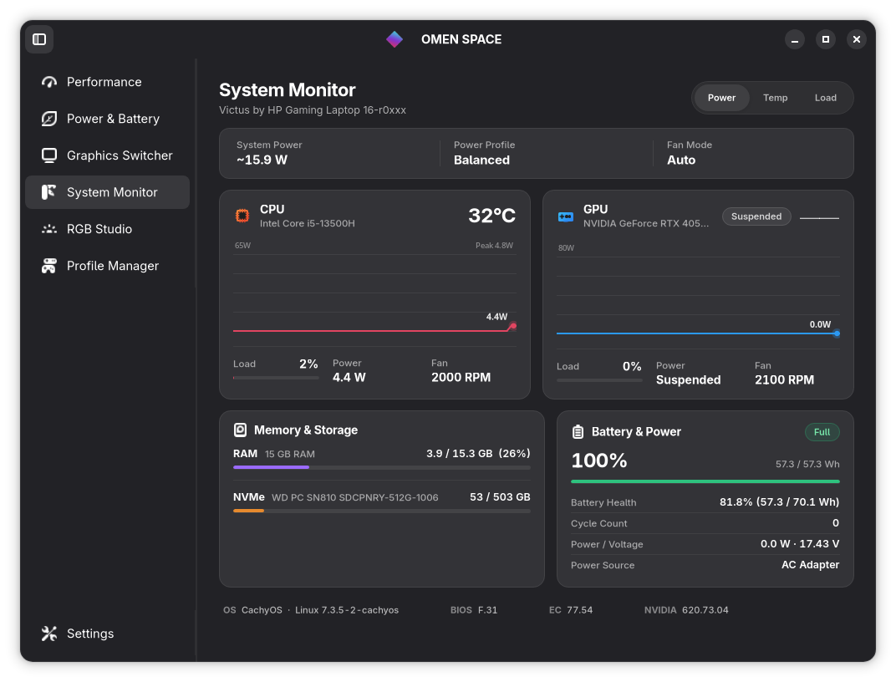
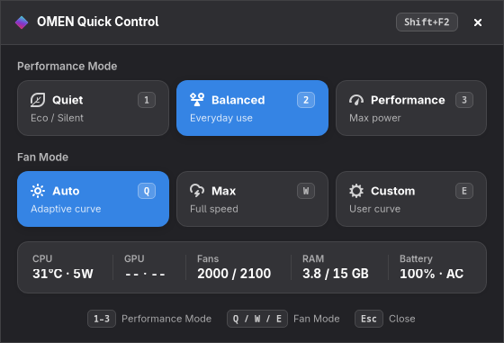

<div align="center">
  

  # OMEN Space

  **Centro de control nativo en Linux para portátiles HP OMEN, Victus y Transcend.**  
  Escrito íntegramente en **Rust** con **GTK4 y Libadwaita** para un rendimiento instantáneo y mínimo consumo.

  <p>
    <a href="https://github.com/yunusemreyl/omen-space/releases/latest">
      
    </a>
    <a href="LICENSE">
      
    </a>
    
    
  </p>

  <p>
    <a href="README.md">English</a> · <b>Español</b>
  </p>

  <br />
  
</div>

---

## Descripción general

**OMEN Space** ofrece control total del hardware en Linux mediante un daemon nativo en Rust (~3 MB) y una interfaz moderna en GTK4 + Libadwaita.

| Módulo | Funciones principales |
| :--- | :--- |
| **Rendimiento y Refrigeración** | Perfiles térmicos `Eco`, `Balanced` y `Performance`; modos de ventilador `Auto`, `Max`, curvas independientes para CPU y GPU con botón rápido **Nuevo preajuste**, delegación al **EC**, limpieza de polvo y barra de telemetría inferior fija sin cajas (`CPU`, `GPU`, `RAM`, `NVMe`, `Batería`). |
| **Monitor del Sistema** | Gráficos en tiempo real de 60 s con selector **Potencia / Temp / Carga** para CPU y GPU, barra resumen de potencia y modos activos, uso por disco, panel dedicado de **Batería y energía** y metadatos de firmware (`OS`, `BIOS`, `EC`, `NVIDIA`). |
| **Energía y Batería** | Limitador de carga de batería HP WMI `0x2B` / nativo con histéresis (`stop`/`start`, protección apagado `hold` y bypass único al 100 %), límites Intel RAPL `PL1`/`PL2`, `TCC Offset`, undervolt por MSR (`UV_LOCK`), GPU Dynamic Boost y ajustes AMD Ryzen SMU. |
| **Selector de Gráficos (MUX y PRIME)** | Cambio validado por hardware entre **Hybrid (MSHybrid)**, **Discrete (dGPU)**, **Advanced Optimus** e **Integrated**, enrutamiento de pantallas, estado pasivo `D3cold` y copia rápida de **PRIME Offload**. |
| **RGB Studio** | Iluminación RGB de 4 zonas, zona única (Victus), barra de luz frontal, Desktop RGB y teclado por tecla HID (Darfon `0d62:54bf` / `0d62:30bf` y Primax `0xFF13`) con vista previa sincronizada, preajustes por tecla guardados, calibración física y distribución EN/DE/TR-Q. |
| **Control Rápido (`Shift+F2`, configurable)** | Superposición flotante nativa en Libadwaita con atajos de teclado (`1–3`, `Q/W/E`), soporte de teclas en múltiples dispositivos y telemetría en vivo. |
| **Centro de Ajustes Unificado** | Pestañas **General \| Actualizaciones \| Diagnóstico** con volcado completo para GitHub, comprobación OTA + `fwupd` (LVFS) y perfiles automáticos por aplicación. |

---

## Instalación rápida

```bash
curl -sSL https://raw.githubusercontent.com/yunusemreyl/omen-space/main/install.sh | sudo bash -s -- --stable
```

Para instalar directamente desde la rama `main` (canary):

```bash
curl -sSL https://raw.githubusercontent.com/yunusemreyl/omen-space/main/install.sh | sudo bash -s -- --canary
```

---

## Galería

<p align="center">
  
  
</p>
<p align="center">
  
  
</p>
<p align="center">
  
  
</p>

<details>
<summary><b>Más vistas (Control Rápido, Actualizaciones, Diagnóstico y CLI)</b></summary>
<br />
<p align="center">
  
  
</p>
<p align="center">
  
  
</p>
</details>

---

## Novedades en v2.6.1

- **Motor RGB fluido con consumo mínimo de CPU:** Bucle unificado `rgb_engine_loop` con reposo a 0 % CPU mediante `tokio::sync::Notify`, renderizado en pila (`render_per_key_rgb`), mapeo precalculado de `LampArray` con diff por bloques sucios, envíos HID por lotes con `O_NONBLOCK`, y vista previa en `omen-gui` a 40 FPS con glifos en caché y fase continua al ajustar la velocidad (`~59.8 µs/fotograma`, `<0.18 %` de 1 núcleo a 30 FPS en `--release`).
- **Cambio automático CA / Batería configurable y restauración completa al conectar CA (`#398`):** Nuevo interruptor **Auto-Switch Profile on AC / Battery** (`Ajustes -> Rendimiento`, `omen-cli power auto-switch on|off`, D-Bus `SetAcAutoSwitch`), restauración del perfil previo al reconectar el cargador, sincronización de `energy_performance_preference` (EPP) de CPU, recuperación de límites RAPL, fallback `performance -> balanced` en `power-profiles-daemon` y restauración de `PL1/PL2` en `hp-wmi.c` tanto en `Balanced` como en `Performance`.

---

## Anteriormente en v2.6.0

- **Preajustes de color por tecla en RGB Studio (`#397`):** Guarda, carga, sobrescribe y elimina distribuciones personalizadas de 104 teclas (`~/.config/omenspace/key_presets.json`) directamente en RGB Studio con detección de edición activa y traducción TR/EN/ES (contribución de [@Dmitriy-Romanov](https://github.com/Dmitriy-Romanov)).
- **RGB Reactivo y Onda Primax de ultra baja latencia (`#385`):** Despertar instantáneo por pulsación en `evdev`, escritura HID por lotes en una sola apertura y diff por páginas sucias en `0461:4F03` (de 10 paquetes/fotograma a 1–3), junto con control completo del deslizador de velocidad en `Reactive` y `Ripple`.
- **Perfiles de energía verificados y diagnóstico UMA (`#396`):** Exclusión de `amd-pmf`, verificación por relectura en `platform_profile` / `thermal_profile`, errores D-Bus explícitos con aviso de modo UMA (`gpu_mux_mode=3`) y reversión automática de la UI/bandeja/overlay si la BIOS rechaza el cambio.
- **Estabilidad térmica en OMEN 16-wf1xxx (`8C76`/`8C77`/`8C78`) (`#395`):** Eliminado el bucle de oscilación `Balanced <-> Performance` con `power-profiles-daemon` y las escrituras a 1 Hz en reposo; modo `Auto` delegado al EC nativo (`prefer_ec_auto_fan`) y mejoras en `hp-wmi` (`PWM_MODE_AUTO` / `max_reset`) para evitar bloqueos al 100 %.
- **Botón de parada inmediata en limpieza de ventiladores (`#364`, `#385`):** Nuevo botón **Detener y volver a Automático** (`CancelFanCleaning`) y corrección de detección monozona (`rgb_zone_count = 1`) en hardware (`#369`).

---

## Documentación y Seguridad

- **[Registro de cambios](CHANGELOG.md)** · **[Política de seguridad](SECURITY.md)** · **[Guía de instalación](docs/INSTALACION.es.md)**

---

## Licencia

Distribuido bajo la licencia **GPL-3.0**.  
*OMEN Space es un proyecto independiente de código abierto y no está afiliado ni respaldado por HP Inc.*
