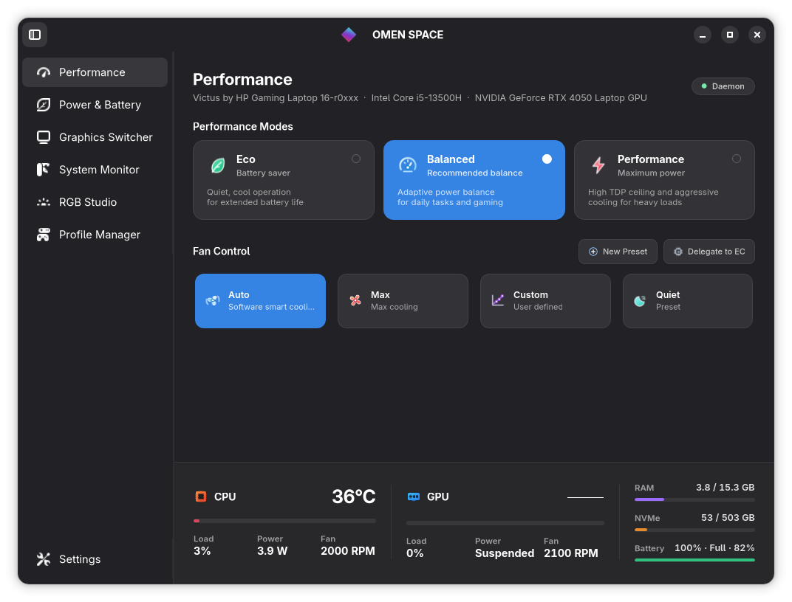
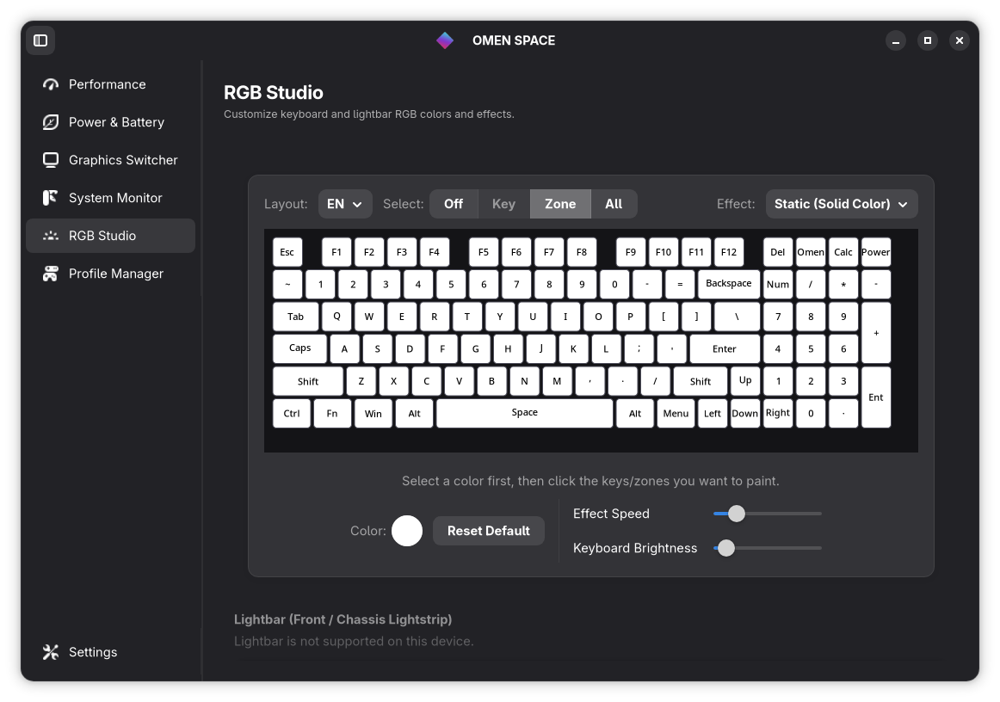
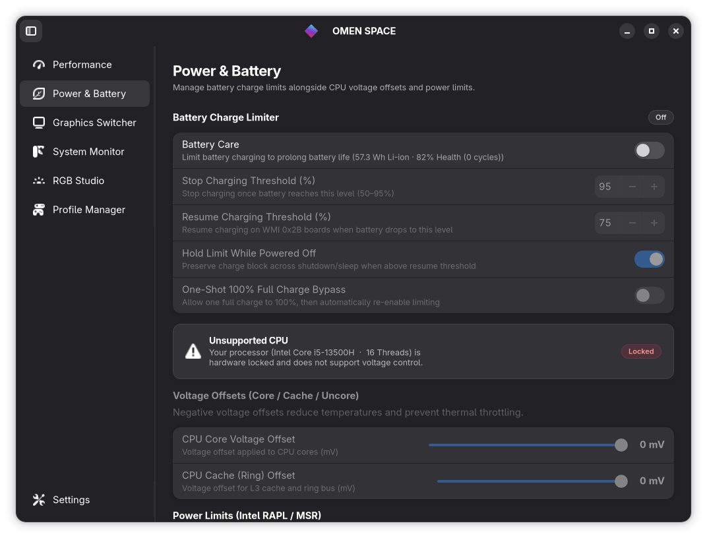
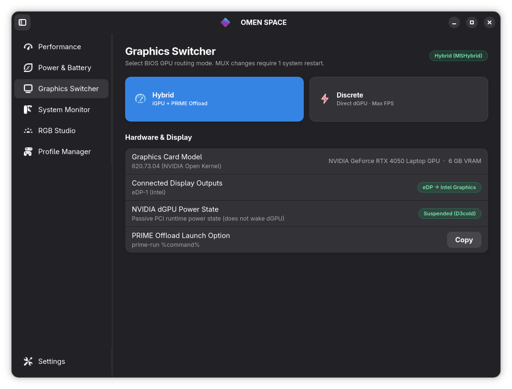
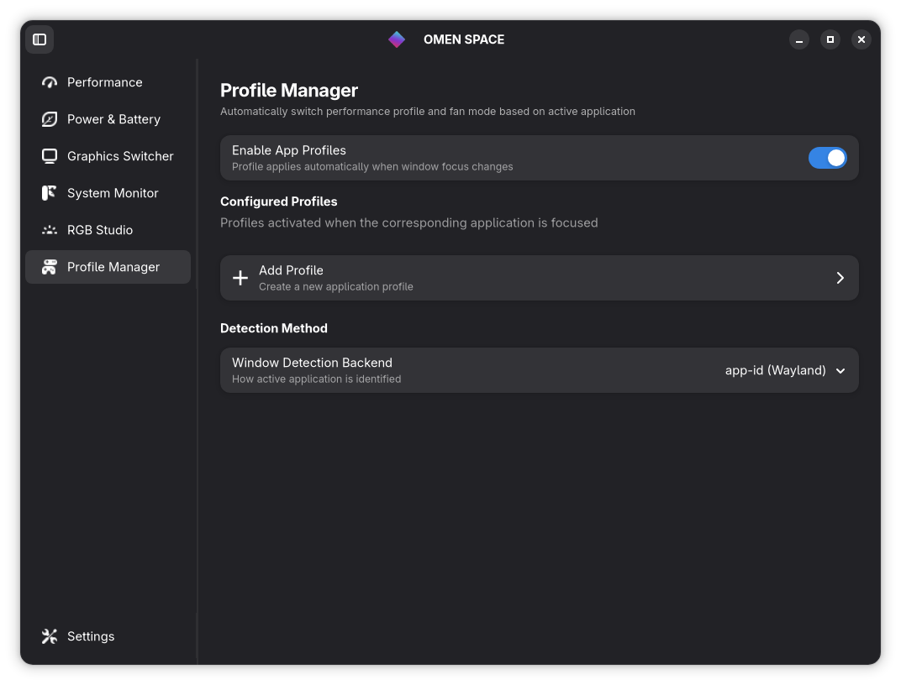
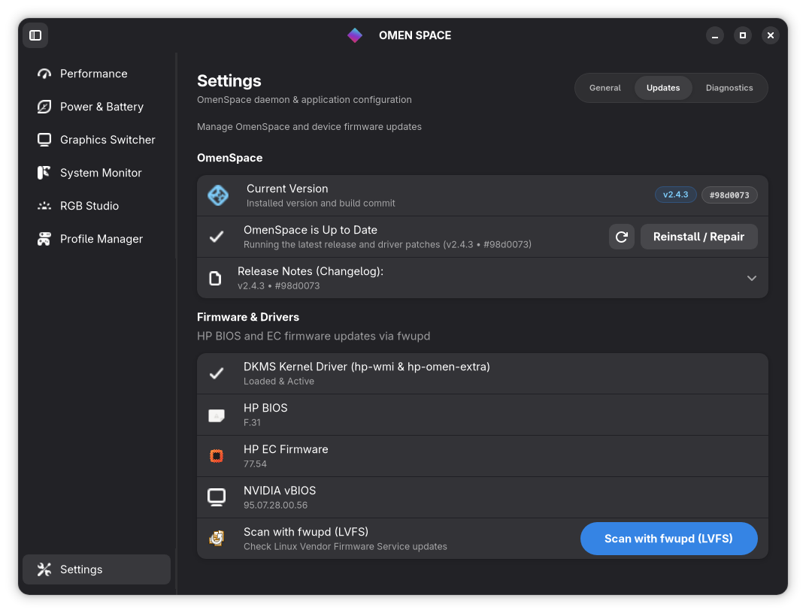

<div align="center">
  

  # OMEN Space

  **Native Linux hardware control center for HP OMEN, Victus & Transcend laptops.**  
  Built from the ground up in **Rust** with **GTK4 & Libadwaita** for near-zero overhead.

  <p>
    <a href="https://github.com/yunusemreyl/omen-space/releases/latest">
      
    </a>
    <a href="LICENSE">
      
    </a>
    
    
  </p>

  <p>
    <b>English</b> · <a href="README.es.md">Español</a>
  </p>

  <br />
  
</div>

---

## Overview

**OMEN Space** replaces bloated background utilities with a ~3 MB native Rust daemon and a responsive GTK4 desktop interface. It talks directly to HP WMI/ACPI interfaces, Embedded Controller (EC) registers, Intel RAPL / MSR, AMD Ryzen SMU, and USB HID lighting controllers over a privileged D-Bus service.

| Module | Capabilities |
| :--- | :--- |
| **Performance & Cooling** | `Eco`, `Balanced`, and `Performance` BIOS thermal profiles; software-smart `Auto` cooling, `Max` fan mode, independent CPU & GPU custom multi-point fan curves with saved presets, one-click **Delegate to EC**, fan dust-cleaning mode, and 3s-debounced `>= 90°C` / `95°C` thermal protection. |
| **Power & Battery** | HP WMI `0x2B` / native battery charge limiter with hysteresis (`stop`/`start` thresholds, shutdown `hold` protection, one-shot 100% bypass), real-time Intel RAPL `PL1`/`PL2` power limits, `TCC Offset`, MSR undervolting (`UV_LOCK` detection), GPU Dynamic Boost (`cTGP`/`PPAB`), and AMD Ryzen SMU tuning. |
| **Graphics Switcher (MUX & PRIME)** | Hardware-gated **Hybrid**, **Discrete (dGPU)**, **Advanced Optimus**, and **Integrated** switching backed by BIOS `/sys/devices/platform/hp-wmi/gpu_mux_supported_modes`, live display routing, passive `D3cold` state, and one-click Steam/app **PRIME Offload** launch copy. |
| **RGB Studio** | 4-Zone OMEN, Single-Zone Victus, chassis Lightbar, Desktop RGB, and HID Per-Key RGB (Darfon `0d62:54bf` / `0d62:30bf` + Primax `0xFF13` McuSDK2) with physical lamp calibration, EN/DE layout toggle, and low-CPU sysfs animations. |
| **Quick HUD (`Shift+F2`, configurable)** | Lightweight Wayland/X11 floating overlay and system tray applet for switching power/fan/MUX profiles on the fly with non-blocking socket probing. |
| **Unified Settings Hub** | Clean **General \| Updates \| Diagnostics** segmented hub with one-click GitHub **Full System Dump**, OTA + `fwupd` (LVFS) update checks, conflict detection, and per-app profiles. |

---

## Installation

Run the one-line installer to automatically detect your distribution, install build dependencies, compile the workspace, and register the DKMS kernel drivers (`hp-wmi` & `hp-omen-extra`):

```bash
curl -sSL https://raw.githubusercontent.com/yunusemreyl/omen-space/main/install.sh | sudo bash -s -- --stable
```

To track the latest commits directly from `main`:

```bash
curl -sSL https://raw.githubusercontent.com/yunusemreyl/omen-space/main/install.sh | sudo bash -s -- --canary
```

<details>
<summary><b>Manual Build, Arch Linux (PKGBUILD), NixOS & Uninstall</b></summary>

#### Manual Install (Ubuntu/Debian, Fedora, Arch, openSUSE)
```bash
git clone https://github.com/yunusemreyl/omen-space.git
cd omen-space
sudo ./setup.sh install
```

#### Arch Linux (`makepkg`)
```bash
git clone https://github.com/yunusemreyl/omen-space.git
cd omen-space
makepkg -si
```

#### NixOS (Flakes)
```bash
nix profile install github:yunusemreyl/omen-space
```

#### Update or Uninstall
```bash
sudo ./setup.sh update      # Pull latest changes, rebuild, and reinstall
sudo ./setup.sh uninstall   # Remove daemon, UI, and DKMS modules cleanly
```
</details>

---

## Interface Gallery

<p align="center">
  
  
</p>
<p align="center">
  
  
</p>
<p align="center">
  
  
</p>

<details>
<summary><b>More Views (Settings & Interactive CLI)</b></summary>
<br />
<p align="center">
  
  
</p>
</details>

---

## Architecture

| Component | Role |
| :--- | :--- |
| **`omen-space-daemon`** | Root service (`systemd` & native `OpenRC`) managing WMI, ACPI, sysfs, EC, MSR/RAPL, and HID devices over D-Bus (`org.hp.omen.*`). |
| **`omen-gui`** | Native GTK4 + Libadwaita desktop application with lazy page startup, scalable UI (`Ctrl+Shift+Plus` / `Minus`), and instant localization (**English**, **Türkçe**, **Español**). |
| **`omen-overlay`** | Lightweight Quick Access HUD (default `Shift+F2`, configurable in Settings) synchronized in real time with the daemon and main GUI. |
| **`omen-tray`** | StatusNotifierItem system tray applet for quick profile switching and background hotkey handling. |
| **`omen-cli`** | Scriptable command-line interface and interactive TUI (`omen-cli system info`, `omen-cli overlay toggle`, `omen-cli system check-update`). |
| **`hp-omen-extra`** | Custom DKMS kernel driver package (`hp-wmi` + `hp-omen-extra`) with Secure Boot MOK auto-signing (`.ko.xz`/`.ko.zst`) exposing fan PWM, thermal profiles, GPU TGP/PPAB, and RGB zones. |

---

## What's New in v2.4.3

- **Unified Settings Hub & Streamlined Graphics Switcher:** Consolidated **Update Center** and **Debug Center** as segmented sub-tabs (**General | Updates | Diagnostics**) inside **Settings** for a cleaner 6+1 sidebar, and redesigned **Graphics Switcher** into compact mode cards with a unified **Hardware & Display** group.
- **Repository Quality, Security & Governance Polish:** Removed unused workspace dependencies/assets and resolved all Clippy warnings (enforced via `-D warnings` in CI); added [SECURITY.md](SECURITY.md), [CHANGELOG.md](CHANGELOG.md), `.github/dependabot.yml`, GitHub Issue/PR templates, and refreshed documentation under [`docs/`](docs/architecture.md).
- **v2.4.2 / v2.4.1 Highlights:** Hardware-gated `gpu_mux_supported_modes` + Linux PRIME helper, HP WMI `0x2B` battery charge limiter in **Power & Battery**, KDE Wayland/X11 non-blocking Quick Overlay (`Shift+F2`) fix, Primax `0xFF13` Per-Key RGB (#385), unified GTK4/Libadwaita theme tokens, and full TR/EN/ES localization.

---

## Documentation & Security

- **[Changelog](CHANGELOG.md)** · **[Security Policy](SECURITY.md)** · **[Known Issues](knownissues.md)**
- **[Architecture Map](docs/architecture.md)** · **[Backend Daemon](docs/backend.md)** · **[Kernel Driver](docs/driver.md)** · **[GUI](docs/gui.md)** · **[CLI](docs/cli.md)** · **[Contributing](docs/CONTRIBUTING.md)**

---

## Credits & License

Licensed under the **GPL-3.0 License**.

- **[yunusemreyl](https://github.com/yunusemreyl)** — Lead Developer
- **[tuxov](https://github.com/tuxov)** — Kernel Module Lead
- Community contributors: [@aloshy0](https://github.com/aloshy0), [@henfiber](https://github.com/henfiber), [@adrianatencia](https://github.com/adrianatencia), [@CodesRahul96](https://github.com/CodesRahul96), [@xcellsior](https://github.com/xcellsior), [@TitoTFP](https://github.com/TitoTFP), [@SafSaf0999](https://github.com/SafSaf0999), [@yijean34-source](https://github.com/yijean34-source), [@ManOfDiamond](https://github.com/ManOfDiamond), [@ASPRNG-PRGMR](https://github.com/ASPRNG-PRGMR), [@WoofahRayetCode](https://github.com/WoofahRayetCode), [@ktarxhun](https://github.com/ktarxhun), [@Dmitriy-Romanov](https://github.com/Dmitriy-Romanov), [@Megh-Rana](https://github.com/Megh-Rana), [@GarsGeekGM](https://github.com/GarsGeekGM), [@ShyVortex](https://github.com/ShyVortex), [@CrosserGamer](https://github.com/CrosserGamer), [@rayyanekaputra](https://github.com/rayyanekaputra), [@darmovys](https://github.com/darmovys), and [@elsinoro](https://github.com/elsinoro).

*Disclaimer: OMEN Space is an independent open-source project and is not affiliated with or endorsed by HP Inc.*
