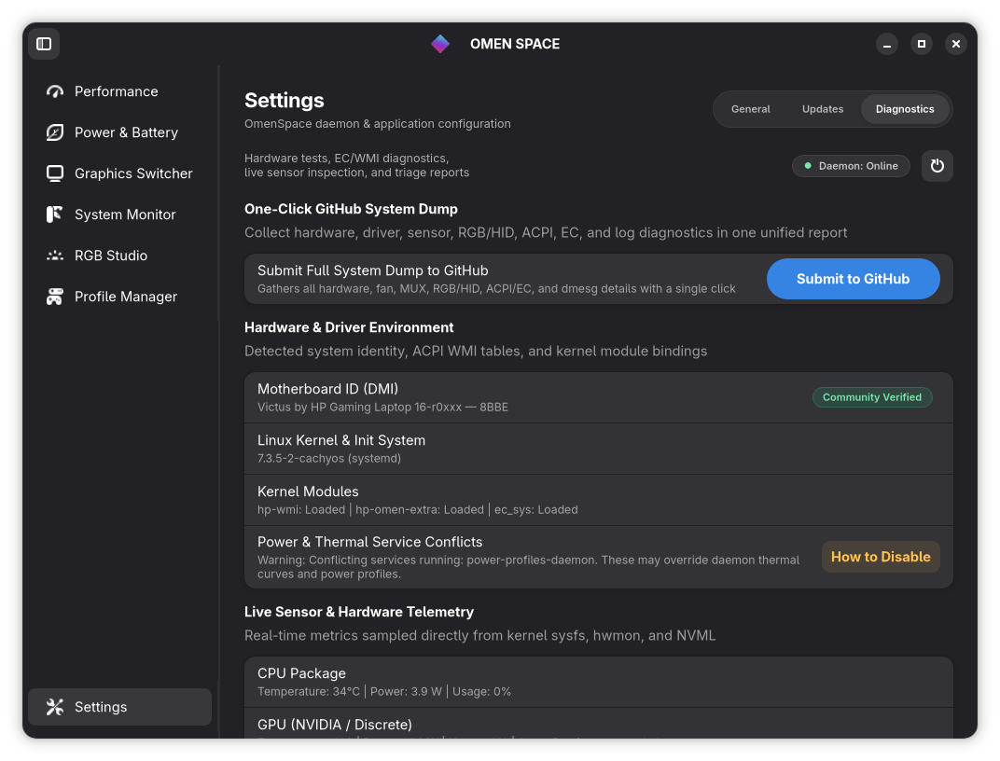
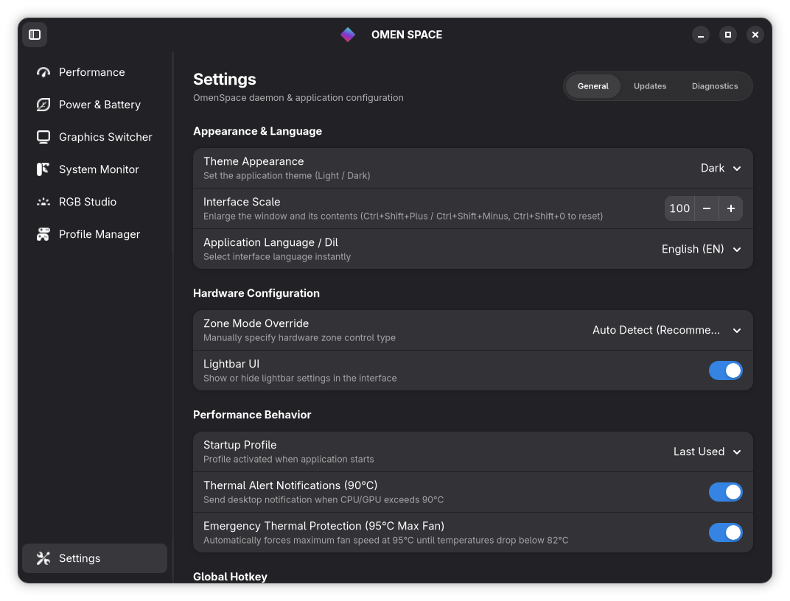

<div align="center">
  

  # OMEN Space

  **Native Linux hardware control center for HP OMEN, Victus & Transcend laptops.**  
  Built from the ground up in **Rust** with **GTK4 & Libadwaita** for near-zero overhead.

  <p>
    <a href="https://github.com/yunusemreyl/omen-space/releases/latest">
      
    </a>
    <a href="LICENSE">
      
    </a>
    
    
  </p>

  <p>
    <b>English</b> · <a href="README.es.md">Español</a>
  </p>

  <br />
  
</div>

---

## Overview

**OMEN Space** replaces bloated background utilities with a ~3 MB native Rust daemon and a responsive GTK4 desktop interface. It talks directly to HP WMI/ACPI interfaces, Embedded Controller (EC) registers, Intel RAPL / MSR, AMD Ryzen SMU, and USB HID lighting controllers over a privileged D-Bus service.

| Module | Capabilities |
| :--- | :--- |
| **Performance & Cooling** | `Eco`, `Balanced`, and `Performance` BIOS thermal profiles; software-smart `Auto` cooling, `Max` fan mode, independent CPU & GPU custom multi-point fan curves with saved presets, one-click **Delegate to EC**, fan dust-cleaning mode, and 3s-debounced `>= 90°C` / `95°C` thermal protection. |
| **Advanced Power** | Real-time Intel RAPL `PL1` / `PL2` power limits (with boot-default tracking up to 250 W / 300 W), `TCC Offset` temperature ceiling, MSR voltage offsets (with hardware `UV_LOCK` detection), GPU Dynamic Boost (`cTGP` / `PPAB`), and AMD Ryzen SMU tuning. |
| **Graphics Switcher (MUX)** | Switch between **Hybrid (MSHybrid)**, **Discrete (dGPU)**, and **Advanced Optimus** modes with live `eDP` display routing, readback verification, and NVIDIA driver telemetry. |
| **RGB Studio** | 4-Zone OMEN, Single-Zone Victus, chassis Lightbar, Desktop RGB, and HID LampArray Per-Key RGB (Darfon `0d62:54bf` / `0d62:30bf`) with physical lamp calibration, EN/DE keyboard layout toggle, low-CPU sysfs animations, and hardware MCU effects. |
| **Quick HUD (`Shift+F2`, configurable)** | Customizable in-game floating overlay and system tray applet for switching power and fan profiles on the fly without leaving your workflow. |
| **Debug Center & Updater** | One-click **Full System Dump** for GitHub diagnostics, automatic per-application rules (Wayland & X11), and an integrated **Update Center** with commit tracking, live build progress, and `fwupd` (LVFS) scanning. |

---

## Installation

Run the one-line installer to automatically detect your distribution, install build dependencies, compile the workspace, and register the DKMS kernel drivers (`hp-wmi` & `hp-omen-extra`):

```bash
curl -sSL https://raw.githubusercontent.com/yunusemreyl/omen-space/main/install.sh | sudo bash -s -- --stable
```

To track the latest commits directly from `main`:

```bash
curl -sSL https://raw.githubusercontent.com/yunusemreyl/omen-space/main/install.sh | sudo bash -s -- --canary
```

<details>
<summary><b>Manual Build, Arch Linux (PKGBUILD), NixOS & Uninstall</b></summary>

#### Manual Install (Ubuntu/Debian, Fedora, Arch, openSUSE)
```bash
git clone https://github.com/yunusemreyl/omen-space.git
cd omen-space
sudo ./setup.sh install
```

#### Arch Linux (`makepkg`)
```bash
git clone https://github.com/yunusemreyl/omen-space.git
cd omen-space
makepkg -si
```

#### NixOS (Flakes)
```bash
nix profile install github:yunusemreyl/omen-space
```

#### Update or Uninstall
```bash
sudo ./setup.sh update      # Pull latest changes, rebuild, and reinstall
sudo ./setup.sh uninstall   # Remove daemon, UI, and DKMS modules cleanly
```
</details>

---

## Interface Gallery

<p align="center">
  
  
</p>
<p align="center">
  
  
</p>
<p align="center">
  
  
</p>

<details>
<summary><b>More Views (Settings & Interactive CLI)</b></summary>
<br />
<p align="center">
  
  
</p>
</details>

---

## Architecture

| Component | Role |
| :--- | :--- |
| **`omen-space-daemon`** | Root service (`systemd` & native `OpenRC`) managing WMI, ACPI, sysfs, EC, MSR/RAPL, and HID devices over D-Bus (`org.hp.omen.*`). |
| **`omen-gui`** | Native GTK4 + Libadwaita desktop application with lazy page startup, scalable UI (`Ctrl+Shift+Plus` / `Minus`), and instant localization (**English**, **Türkçe**, **Español**). |
| **`omen-overlay`** | Lightweight Quick Access HUD (default `Shift+F2`, configurable in Settings) synchronized in real time with the daemon and main GUI. |
| **`omen-tray`** | StatusNotifierItem system tray applet for quick profile switching and background hotkey handling. |
| **`omen-cli`** | Scriptable command-line interface and interactive TUI (`omen-cli system info`, `omen-cli overlay toggle`, `omen-cli system check-update`). |
| **`hp-omen-extra`** | Custom DKMS kernel driver package (`hp-wmi` + `hp-omen-extra`) with Secure Boot MOK auto-signing (`.ko.xz`/`.ko.zst`) exposing fan PWM, thermal profiles, GPU TGP/PPAB, and RGB zones. |

---

## What's New in v2.4.2

- **Hardware-Gated GPU MUX & Linux Advanced Optimus UX:** Exposed real BIOS MUX mode capabilities via `/sys/devices/platform/hp-wmi/gpu_mux_supported_modes`, hid Advanced Optimus automatically on unsupported laptops across GUI and Tray, added passive dGPU D3cold power state & connected display routing details, and introduced a **Linux GPU Switching & one-click Steam/PRIME Offload** guide.
- **Battery Charge Limiter (`0x2B` GBCC/SBCC) in Power & Battery:** Added kernel `hp-wmi` `battery_charge_mode` + daemon hysteresis limiter (`stop`/`start` thresholds, shutdown `hold` mode, and one-time full charge bypass) inspired by `hp-charge-limit-rs`, placed at the top of the renamed **Power & Battery** page.
- **Shift+F2 / Quick Overlay Fix on Wayland/X11:** Converted Unix socket liveness checks to non-blocking `SOCK_NONBLOCK | SOCK_CLOEXEC` to eliminate KDE Wayland `/tmp/.X11-unix/X1` connection deadlocks, preferred `:0` over `:1`, and added 250 ms hotkey debounce.
- **Primax `0xFF13` Per-Key RGB Backend:** Added McuSDK2 HID support for Primax per-key keyboards (`0461:4F03`, `4E9A`, `4E9B`, `4F11`, `4F1E`, `4ECB`, #385).
- **v2.4.1 / v2.4.0 Highlights:** Unified GTK4/Libadwaita styling tokens, complete TR/EN/ES localization, configurable Quick HUD hotkey, ~33% faster lazy-loaded GUI startup (#384, #386), independent CPU/GPU fan curves (#371), Darfon `0d62:30bf` LampArray support (#376, #378, #379), and native OpenRC support (#364).

---

## Credits & License

Licensed under the **GPL-3.0 License**.

- **[yunusemreyl](https://github.com/yunusemreyl)** — Lead Developer
- **[tuxov](https://github.com/tuxov)** — Kernel Module Lead
- Community contributors: [@aloshy0](https://github.com/aloshy0), [@henfiber](https://github.com/henfiber), [@adrianatencia](https://github.com/adrianatencia), [@CodesRahul96](https://github.com/CodesRahul96), [@xcellsior](https://github.com/xcellsior), [@TitoTFP](https://github.com/TitoTFP), [@SafSaf0999](https://github.com/SafSaf0999), [@yijean34-source](https://github.com/yijean34-source), [@ManOfDiamond](https://github.com/ManOfDiamond), [@ASPRNG-PRGMR](https://github.com/ASPRNG-PRGMR), [@WoofahRayetCode](https://github.com/WoofahRayetCode), [@ktarxhun](https://github.com/ktarxhun), [@Dmitriy-Romanov](https://github.com/Dmitriy-Romanov), [@Megh-Rana](https://github.com/Megh-Rana), [@GarsGeekGM](https://github.com/GarsGeekGM), [@ShyVortex](https://github.com/ShyVortex), [@CrosserGamer](https://github.com/CrosserGamer), [@rayyanekaputra](https://github.com/rayyanekaputra), [@darmovys](https://github.com/darmovys), and [@elsinoro](https://github.com/elsinoro).

*Disclaimer: OMEN Space is an independent open-source project and is not affiliated with or endorsed by HP Inc.*
