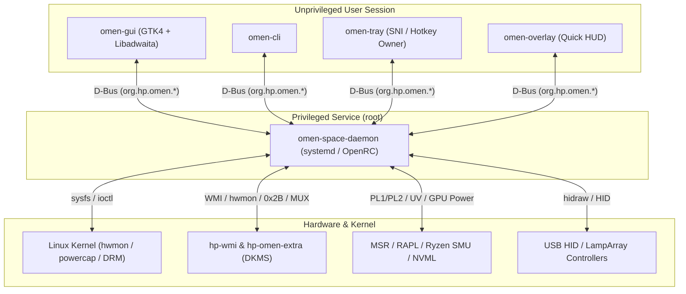

# OMEN Space Architecture Map

This document outlines how **OMEN Space** interacts with HP/Intel/AMD/NVIDIA hardware, its inter-process communication boundaries, and the layout of the workspace.

## 1. High-Level Architecture

OMEN Space follows a **split-privilege client-server architecture** over the Linux System **D-Bus**:

### Why split privileges?
Direct hardware manipulation (fan targets, WMI/EC writes, MSR/RAPL limits, firmware battery charge modes, HID lighting packets) requires `root`. Isolating hardware writes inside `omen-space-daemon` and exposing a validated D-Bus API keeps all desktop clients completely unprivileged.

---

## 2. Workspace Crates & Directories

| Crate / Path | Role |
| :--- | :--- |
| **`src/omen-space-daemon/`** | Root hardware daemon (`tokio` + `zbus`) managing thermal profiles, independent CPU/GPU fan curves, WMI `0x2B` / native battery charge limits, Intel RAPL/MSR & Ryzen SMU, GPU MUX/PRIME topology, USB HID RGB, and evdev hotkeys. |
| **`src/omen-gui/`** | GTK4 + Libadwaita desktop app (6 core hardware tabs + unified Settings Hub with **General \| Updates \| Diagnostics**, UI scaling, TR/EN/ES localization). |
| **`src/omen-overlay/`** | Lightweight Wayland/X11 Quick HUD (`Shift+F2` default, configurable) for instant profile/fan switching and live telemetry. |
| **`src/omen-tray/`** | StatusNotifierItem tray applet that owns background hotkey signal handling (`MacroKeyPressed`) and hardware-gated GPU MUX quick toggles. |
| **`src/omen-cli/`** | Scriptable CLI and interactive TUI (`omen-cli system info`, `omen-cli power set-mux`, `omen-cli overlay toggle`). |
| **`src/omen-types/`** | Shared telemetry types, hotkey specification parsing, and non-blocking Unix socket/display environment utilities. |
| **`driver/`** | Custom DKMS C kernel modules (`hp-wmi` & `hp-omen-extra`) with Clang/LLVM detection and Secure Boot MOK signing support. |
| **`data/`** | `systemd` & `OpenRC` service units, D-Bus policy (`org.hp.omen.conf`), sysusers config, udev rules (`99-omen-space.rules`), and `.desktop` launcher. |
